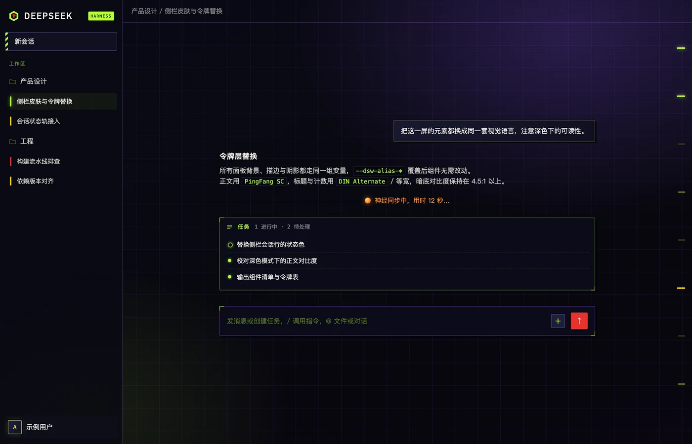
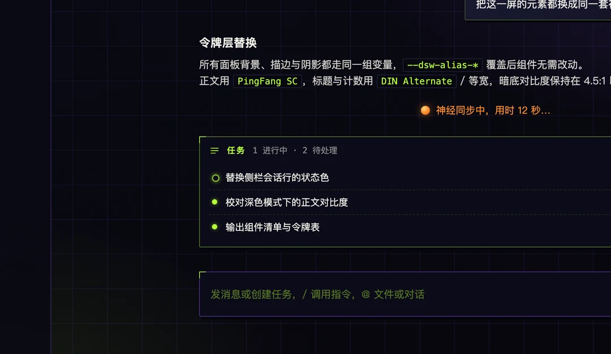
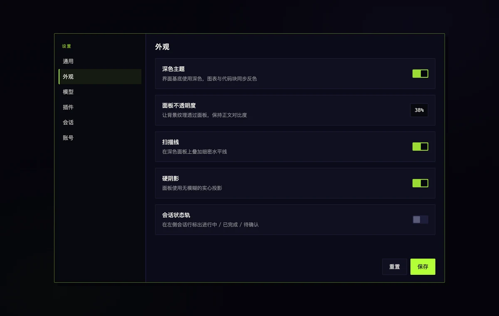

# dsh-eva-skin

给 **DeepSeek Harness Web UI** 换一套 EVA 赛璐璐（cel-shade）皮：墨线描边、无模糊硬投影、扫描线、会话状态轨。

纯客户端插件 —— 不渲染组件、不注册服务、不碰官方类名，只往 `<head>` 里放一张样式表，靠覆盖官方 `--dsw-*` 设计令牌生效。官方改版、换类名、加页面，最多是一条装饰失效，不会把界面改坏。

> EVA cel-shade skin for the DeepSeek Harness Web GUI. Client-only CSS token overrides: ink outlines, hard shadows, scanlines, session status rails.

## 截图

> 下图为界面示意的设计稿（mock），不是真实会话截图：内容为假数据，仅用于展示配色、面板形状与状态轨。



| 输入区与任务面板 | 设置面板 |
| --- | --- |
|  |  |

## 效果

| 位置 | 变化 |
| --- | --- |
| 配色 | 初号机紫 `#7B4BD8`、零号机蓝 `#2E6BE6`、二号机红 `#E8322D`、荧光绿 `#B4FF39`、警示黄 `#FFD400`，墨黑描边 `#04040A` |
| 形状 | 方角 + 墨线 + 无模糊硬投影（`box-shadow: n n 0`） |
| 质感 | 全屏 CRT 扫描线（可关）、选中标签页改墨底荧光字 |
| 左栏会话行 | 3px 状态轨：绿=运行中（呼吸）、黄=已完成、红=等你回复 |
| 右侧跳转条 | 荧光绿刻度，悬停变亮，当前条为警示黄 |
| 底图 | 可选一张压暗的背景图（默认关闭，见「自定义底图」） |

## 安装

插件市场里搜 `dsh-eva-skin`（包名 `@winstonlu/dsh-eva-skin`），或让 agent 直接装：

```
plugin_manager install_bundle @winstonlu/dsh-eva-skin
```

从 git 装（没有 npm 包时）：

```
plugin_manager install_bundle git+https://github.com/luwendi-qq/dsh-eva-skin#<commit>
```

本地开发装法：

```
plugin_manager install_bundle file:/绝对路径/winstonlu-dsh-eva-skin-1.0.0.tgz
```

装完在插件页启用，页面刷新一次即可看到（纯 CSS 改动只需刷新，不必重启）。

## 配置

在 profile 的 `cordis.patch.yml` 里给 `dsh-eva-skin` 这一行加 config（全部可选）：

```yaml
- id: dsh-eva-skin
  config:
    scanlines: true    # 扫描线，默认 true
    hardShadow: true   # 无模糊硬投影，默认 true
    forceDark: false   # 强制暗色，默认 false
    backdrop: false    # 背景图，默认 false（见下）
```

> **坑位提醒（写给插件作者）**：配置要从 `apply(ctx, config)` 的第二个参数拿。
> cordis 里 `config` 是服务，没在 `inject` 里声明就读 `ctx.config` 会抛
> `cannot get property "config" without inject`；apply 抛错后条目永远停在
> `loading`，而桌面端启动审计把非 active 条目当致命错误，直接重启 app。

## 自定义底图

```bash
./tools/set-background.sh 你的图.png 0.95   # 第二个参数是亮度，省略默认 0.62
# 输出 ~/.dsh/backups/pkgs/dsh-eva-skin-<version>.tgz
plugin_manager install_bundle file:~/.dsh/backups/pkgs/dsh-eva-skin-<version>.tgz
```

脚本会把图压到 1536 宽、转 WebP q74 内嵌进 `lib/client.js`，再打进包里。
不想内嵌图片（比如要发布到公共 npm）就先跑 `./tools/strip-background.sh`，
它把 data URI 换回纯 CSS 渐变底，包体从 ~130KB 掉到 ~25KB。

包内默认携带一张本地 AI 生成的同人风格插画（`lib/client.js` 里内嵌 WebP）；想换图就再跑一次这个脚本，想彻底去掉图就跑 `./tools/strip-background.sh`。

## 卸载

插件页点卸载，或：

```
plugin_manager remove_bundle @winstonlu/dsh-eva-skin
```

`dispose()` 会移除样式表、开关属性、底图层和角标，不残留。

## 兼容性

- 需要 DSH `>=0.2.0-rc.2`（`engines.dsh`）
- 仅 Web 客户端（`dsh.client.platform: "web"`），桌面端与浏览器端同一份 UI
- 不依赖 CSS-in-JS 哈希类名；只用到侧栏会话行的 `data-row-key^="session:"` 与跳转条的官方语义锚点

## 开发

```bash
node --check lib/client.js
node ~/.dsh/dsh-runtimes/dsh-primary-runtime/dependencies/pnpm/bin/pnpm.cjs pack --pack-destination ~/.dsh/backups/pkgs
plugin_manager install_bundle file:$HOME/.dsh/backups/pkgs/winstonlu-dsh-eva-skin-<ver>.tgz
```

改完刷新页面（`unlag` 刷新按钮，或在右键菜单里允许 agent 自己刷新）。

## License

MIT。EVA / 新世纪福音战士及其角色与机体版权归 khara / 庵野秀明所有，本项目只是配色致敬，不包含任何官方素材。
