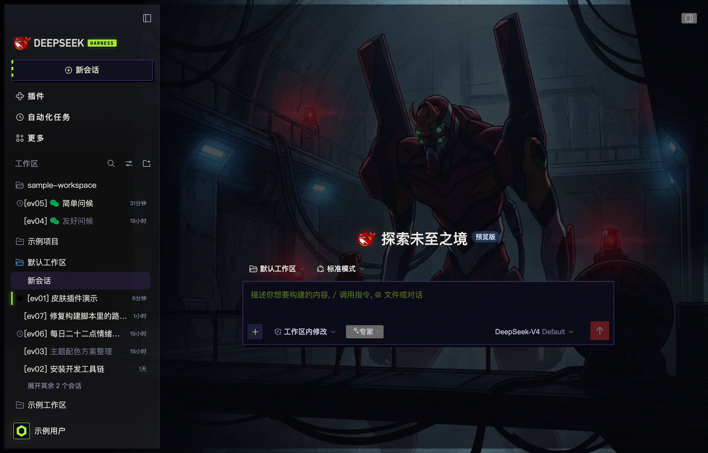

# dsh-eva-skin

给 **DeepSeek Harness Web UI** 换一套 EVA 赛璐璐（cel-shade）皮：墨线描边、无模糊硬投影、扫描线、会话状态轨。

纯客户端插件 —— 不渲染组件、不注册服务、不碰官方类名，只往 `<head>` 里放一张样式表，靠覆盖官方 `--dsw-*` 设计令牌生效。官方改版、换类名、加页面，最多是一条装饰失效，不会把界面改坏。

> EVA cel-shade skin for the DeepSeek Harness Web GUI. Client-only CSS token overrides: ink outlines, hard shadows, scanlines, session status rails.

## 截图

两张图都是从运行中的真实界面导出的 DOM 重新渲染的：界面原样、皮肤原样，只把会话名、工作区、用户名换成了占位内容，并隐去了头像与挂件气泡。




| 细节 | 说明 |
| --- | --- |
|  | 品牌徽记与 HARNESS 铭牌、会话状态灯、AT 力场思考态、方形头像、右侧跳转条、输入区 |

## 效果

| 位置 | 变化 |
| --- | --- |
| 配色 | 初号机紫 `#7B4BD8`、零号机蓝 `#2E6BE6`、二号机红 `#E8322D`、荧光绿 `#B4FF39`、警示黄 `#FFD400`，墨黑描边 `#04040A` |
| 形状 | 方角 + 墨线 + 无模糊硬投影（`box-shadow: n n 0`） |
| 质感 | 全屏 CRT 扫描线（可关）、选中标签页改墨底荧光字 |
| 左栏会话行 | 3px 状态轨：绿=运行中（呼吸）、黄=已完成、红=等你回复 |
| 右侧跳转条 | 荧光绿刻度，悬停变亮，当前条为警示黄 |
| 底图 | 可选一张压暗的背景图（包内自带一张，见「自定义底图」） |
| 新会话动态底 | 新建会话的空状态窗口先演 5 秒视频（EVA 初号机出场，静音自动播放、只播一次），进入具体对话即淡出（见「新会话动态底」） |

## 安装

插件市场里搜 `dsh-eva-skin`（包名 `@winstonlu/dsh-eva-skin`），或让 agent 直接装：

```
plugin_manager install_bundle @winstonlu/dsh-eva-skin
```

从 git 装（没有 npm 包时）：

```
plugin_manager install_bundle git+https://github.com/luwendi-qq/dsh-eva-skin#<commit>
```

本地开发装法：

```powershell
# Windows：打包产物在 $env:DSH_HOME\backups\pkgs（未设置 DSH_HOME 时是 ~\.dsh\backups\pkgs）
plugin_manager install_bundle file:$env:DSH_HOME\backups\pkgs\winstonlu-dsh-eva-skin-<version>.tgz
```

```bash
# macOS / Linux
plugin_manager install_bundle file:$HOME/.dsh/backups/pkgs/winstonlu-dsh-eva-skin-<version>.tgz
```

装完在插件页启用，页面刷新一次即可看到（纯 CSS 改动只需刷新，不必重启）。

## 配置

在 profile 的 `cordis.patch.yml` 里给 `dsh-eva-skin` 这一行加 config（全部可选）：

```yaml
- id: dsh-eva-skin
  config:
    scanlines: true    # 扫描线，默认 true
    hardShadow: true   # 无模糊硬投影，默认 true
    backdrop: true     # 静态底图，默认 true（设为 false 连动态底一起关）
    backdropVideo: true # 新会话空态的动态视频底，默认 true（见下）
```

> **坑位提醒（写给插件作者）**：配置要从 `apply(ctx, config)` 的第二个参数拿。
> cordis 里 `config` 是服务，没在 `inject` 里声明就读 `ctx.config` 会抛
> `cannot get property "config" without inject`；apply 抛错后条目永远停在
> `loading`，而桌面端启动审计把非 active 条目当致命错误，直接重启 app。

## 自定义底图

换图需要 **Python 3 + Pillow**（只有这个功能用到；打包、去图都只依赖 Node，不需要额外装东西）。
先装依赖：

```powershell
python -m pip install pillow        # Windows
```

```bash
python3 -m pip install pillow       # macOS（系统自带 / Homebrew 都是 python3 命令）
```

然后换图并打包（Windows PowerShell）：

```powershell
python tools/set-background.py 你的图.png 0.95    # 第二个参数是亮度，省略默认 0.95
# 输出 $env:DSH_HOME\backups\pkgs\winstonlu-dsh-eva-skin-<version>.tgz（未设置 DSH_HOME 时是 ~\.dsh\backups\pkgs）
plugin_manager install_bundle file:$env:DSH_HOME\backups\pkgs\winstonlu-dsh-eva-skin-<version>.tgz
```

macOS / Linux 换 `python3` 调用：

```bash
python3 tools/set-background.py 你的图.png 0.95
# 输出 $DSH_HOME/backups/pkgs/…（没设 DSH_HOME 就是 ~/.dsh/backups/pkgs/…）
plugin_manager install_bundle file:$HOME/.dsh/backups/pkgs/winstonlu-dsh-eva-skin-<version>.tgz
```

脚本会把图压到宽 ≤1536、按亮度调暗、转 WebP q74 内嵌进 `lib/client.js`，patch 版本号 +1、同步
`package.json` 的 `version`，最后打包。几个约定：

- 输出目录优先读 `DSH_HOME` 环境变量（Windows 上如 `F:\临时\dsh`，macOS 上如 `~/.dsh`），没设置就回退 `~/.dsh`，再拼 `backups/pkgs`。
- 包名是 `winstonlu-dsh-eva-skin-<version>.tgz`：npm / pnpm 打包会去掉 `@winstonlu/` 这个 scope 前缀、换成 `winstonlu-`。
- 打包优先用 `pnpm pack`（PATH 里有 pnpm 时），否则用 `npm pack`；两者都支持 `--pack-destination`。
- 脚本跑完会直接把可复制的 `plugin_manager install_bundle target=file:…` 一行打出来。

不想内嵌图片（比如要发布到公共 npm）就先跑：

```powershell
node tools/strip-background.mjs      # Windows / macOS 通用，纯 Node、无依赖
```

它把 data URI 换回纯 CSS 渐变底；之后想换回图片，直接再跑一次 `set-background.py` 即可。
去图后打包体（tgz）从 ~75KB 掉到 ~27KB。

包内默认携带一张本地 AI 生成的同人风格插画（`lib/client.js` 里内嵌 WebP）；想换图就再跑一次
`set-background.py`，想彻底去掉图就跑 `node tools/strip-background.mjs`。

## 新会话动态底（视频）

「新会话」那个空状态窗口（官方 DOM 里 `[data-phase="hero"]`，即 sessionId 为空 / `shellPhase=blank`
的会话根）底下垫的是一段视频：进窗即演、**只播一次**，播完停在最后一帧；一进入具体对话就淡出，
换回上面那张静态插画；下次再进新会话窗口时从头再演一遍。

- **只认语义锚点**：判定只看官方 conversation 根上的 `data-phase`，不碰 `hash_` 类名，换 DSH 版本不会失效。
- **只播一次**：不 `loop`，播完停在最后一帧（那一帧本身就是完整的出场画面），不会来回循环晃眼。
- **只在看得见时解码**：离开空态、切到后台标签页都会 `pause()`；`prefers-reduced-motion: reduce` 时整层不装。
- **自动播放**：视频静音（音轨在编码时就丢掉了），满足浏览器的 muted autoplay 策略；万一被策略拦下，
  停在第一帧封面上，不报错、不闪白。
- **压暗与静态底一致**：视频层上压同一套中心暗的径向渐变，正文对比度不变。

包内自带一段 1600×900 / H.264 / 24fps / 5.17s、无音轨的片段（约 1.1MB，base64 内嵌后约 1.5MB 进包，播一次约 5 秒）。
换素材：

```bash
# 有 ffmpeg：直接从原始视频压（会丢音轨、scrub 到 faststart、顺手抓封面）
node tools/set-background-video.mjs 你的视频.mp4
node tools/set-background-video.mjs 你的视频.mp4 --width 1280 --bitrate 1000000   # 体积敏感时

# 没有 ffmpeg：自己压好再喂进来（H.264 / 无音轨 / ≤2MB 最舒服）
node tools/set-background-video.mjs --video 已压好.mp4 --poster 封面.webp
```

脚本会替换 `lib/client.js` 里的 `VIDEO_MP4_BASE64` 与 `VIDEO_POSTER_DATA_URI`、patch 版本号 +1、
同步 `package.json`，再 `node --check`，然后把打包命令打出来。想关掉这个功能：`backdropVideo: false`，
或者跑 `node tools/strip-background.mjs` 把视频和静态图一起摘掉。

## 卸载

插件页点卸载，或：

```
plugin_manager remove_bundle @winstonlu/dsh-eva-skin
```

`dispose()` 会移除样式表、开关属性、静态底图层、动态底视频层（含 Blob URL 释放）和角标，不残留。

## 兼容性

- 需要 DSH `>=0.2.0-rc.2`（`engines.dsh`）
- 仅 Web 客户端（`dsh.client.platform: "web"`），桌面端与浏览器端同一份 UI
- 不依赖 CSS-in-JS 哈希类名；只用到侧栏会话行的 `data-row-key^="session:"` 与跳转条的官方语义锚点

## 开发

工具链是跨平台的 Node / Python 脚本，Windows PowerShell 与 macOS 通用；各脚本单独用法见
[tools/README](tools/README.md)。

```bash
node --check lib/client.js            # 语法检查，等价于 npm run check
node tools/strip-background.mjs       # 去内嵌底图 + 动态底视频，等价于 npm run strip
node tools/set-background-video.mjs   # 换动态底视频（见上）
```

打包到 DSH 的 pkgs 目录（`DSH_HOME/backups/pkgs`，未设置时回退 `~/.dsh/backups/pkgs`）：

```powershell
# Windows PowerShell
npm pack --pack-destination "$env:DSH_HOME\backups\pkgs"
```

```bash
# macOS / Linux
npm pack --pack-destination "${DSH_HOME:-$HOME/.dsh}/backups/pkgs"
```

也可以用 `npm run pack`（= `python tools/set-background.py --pack-only`，会自己解析 `DSH_HOME`）。
`npm run bg` / `npm run pack` 这两个脚本依赖 `python` 命令；macOS 上如果只有 `python3`，
直接用 `python3 tools/set-background.py …` 调用即可。装包：

```
plugin_manager install_bundle file:<上面打印出来的 tgz 路径>
```

### 排查：选择器体检

CSS module 的哈希前缀是**按 DSH 构建**生成的（`kb3qhq_` / `csseja_` / `mAYO5W_` …），换一版 DSH
或换一台机器就可能全部静默失效。改完皮肤、或要在别的构建上验证时：

```powershell
node tools/audit-selectors.mjs --asar "D:/Program Files/DSH/DSH NEXT/resources/app.asar"
```

退出码 `1` 表示皮肤里有 `[class*=…]` 选择器在当前构建里 0 命中（已失效）；全部命中则退出码 `0`。
也可以 `--dir <已解包的 resources 目录>`，或 `--classes <每行一个类名的文本文件>`。

改完刷新页面（`unlag` 刷新按钮，或在右键菜单里允许 agent 自己刷新），纯 CSS 改动不需要重启。

## License

MIT。EVA / 新世纪福音战士及其角色与机体版权归 khara / 庵野秀明所有，本项目只是配色致敬，不包含任何官方素材。
